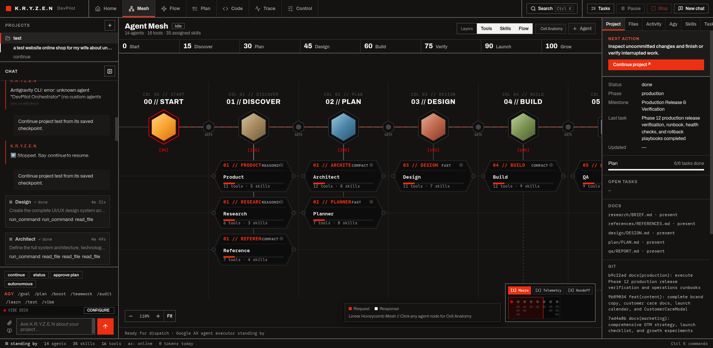
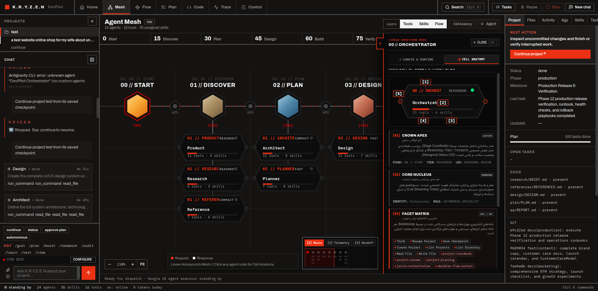

<p align="center">
  
</p>

<p align="center">
  <strong>Autonomous AI Product Engineering Mesh &amp; Vibe Studio</strong><br>
  <em>Industrial-grade Swiss-Modernist telemetry engine with zero third-party pip dependencies.</em>
</p>

<p align="center">
  <a href="https://github.com/Hossein4163/KRYZEN/actions"></a>
  <a href="LICENSE"></a>
  <a href="#architecture"></a>
  <a href="#pipeline"></a>
  <a href="#autonomous-teammates"></a>
  <a href="#vibe-studio"></a>
  <a href="#telemetry"></a>
  <a href="#antigravity-cli"></a>
</p>

---

## ⚡ What is K.R.Y.Z.E.N?

**K.R.Y.Z.E.N** is a sovereign, local-first autonomous software engineering mesh. It coordinates a team of **14 specialized AI agents** that take any idea from zero to a fully deployed production product inside your own local filesystem.

Instead of chaotic multi-agent chatter, K.R.Y.Z.E.N operates like a high-precision Swiss watch: deterministic Manhattan 90° circuit-board routing, elongated 6-facet honeycomb nodes, real-time microsecond Server-Sent Events (SSE) telemetry, stage gate circuit breakers, and an interactive **Vibe Studio** for tactile prompt engineering.

<p align="center">
  
</p>

---

## ✨ Key Highlights

- **Zero Third-Party Pip Dependencies**: The entire backend engine, SSE stream multiplexer, state machines, and RPC bridges run purely on standard Python 3 (`http.server`, `urllib`, `sqlite3`, `json`, `subprocess`).
- **Linear Honeycomb Mesh Architecture**: 6-facet hexagonal agent nodes with dedicated Inbound Bus Docking, Outbound Bus Docking, Status Crown, LED Pulse Core, and Micro-Facet telemetry trackers.
- **Vibe Studio Telemetry**:
  - **Click-to-Prompt**: Click any element on live generated interfaces to auto-compose context-aware refinement prompts.
  - **Point-and-Tweak Inspector**: Live CSS dial overrides, typography metrics, and spacing physics with instant hot-reload.
  - **Time Travel Checkpoints**: Deterministic state snapshots with 1-click regression rollback.
- **Project stage gates**: Hold entry to later stages of a project's agent workflow. Gate state persists across reloads and server restarts.
- **Model Agnostic & Hot-Swappable**: Seamlessly route Reasoning Tier (`gemini-3.8-flash`, `claude-3.5-sonnet`), Fast Tier (`gemini-3-flash`), or Local Offline Tier (`ollama/qwen2.5-coder`) per agent node without restarting the daemon.
- **Obscura Ultralight Browser Automation**: Native integration with [Obscura](https://github.com/h4ckf0r0day/obscura), a high-performance Rust headless browser powered by the V8 JavaScript engine. Replaces heavy 250MB+ Chromium instances with an ultra-lightweight ~30MB memory footprint, sub-second cold starts, native DOM scraping, TLS fingerprint impersonation, and anti-tracker stealth protection.
- **Isolated Agent Box & Branch-Per-Change**: Safe sandboxed staging (`.devpilot/isolated/`) with atomic merge conflict detection and dedicated branch per change merged upon automated test pass and user approval.
- **Autonomous Persistent Teammates (Rakazo Mesh)**: Dedicated **Bots** workstation with persistent bot identities, system prompts, routines (schedules & triggers), computer sandbox inspection, and memory boundaries (isolated vs. shared).
- **Antigravity CLI (`agy`) Native Compatibility**: Fully integrated with Google Antigravity (`agy`) CLI using Bubblewrap sandboxing and non-interactive permission bypass (`--dangerously-skip-permissions`) for smooth, unattended agent workflows.
- **RESTful Teammate API**: Full REST interface for bot management, execution, routines, and sandbox inspection (`/api/bots`, `/api/bot`, `/api/bots/save`, `/api/bots/delete`, `/api/bots/run`, `/api/bots/computer`, `/api/bots/routine`).

---

## 📐 Honeycomb Cell Anatomy

Each agent in the K.R.Y.Z.E.N telemetry mesh is represented as an elongated **6-Facet Linear Honeycomb Cell** engineered for clear visualization of complex agentic execution pipelines:

<p align="center">
  
</p>

| Part | Component | Function |
| :---: | :--- | :--- |
| **01** | **Status Crown** | Displays stage index (`00`..`07`), agent codename, and compute tier badge (`REASONING`, `FAST`, `COMPACT`). |
| **02** | **LED Pulse Core** | Hexagonal live telemetry pulse beacon indicating active execution, idle readiness, or warning states. |
| **03** | **Execution Matrix** | Dynamically tracks call count, execution time, token burn rate, and real-time step counters. |
| **04** | **Facet Counter** | Granular tally of sandboxed tool permits and loaded capability skills bound to the agent. |
| **05** | **Bus Docking Ports** | Dual docking ports (-98px inbound / +98px outbound) connecting orthogonal Manhattan telemetry circuit traces. |

---

## 🚀 The 0-to-100 Autonomous Lifecycle

```
[00 START] ──> [15 DISCOVER] ──> [30 PLAN] ──> [45 DESIGN] ──> [60 BUILD] ──> [75 VERIFY] ──> [90 LAUNCH] ──> [100 GROW]
     │              │               │              │             │              │              │              │
Orchestrator     Research        Planner        Design         Build           QA            DevOps          SEO
               & Reference                    & Tokens      (Full-Stack)   (Chromium E2E)  & Security     & Marketing
```

1. **Intake & Product Strategy**: Transforms raw user intent into PRDs, user personas, core user journeys, and scoped acceptance criteria (`PRD.md`, `BRIEF.md`).
2. **Research & Benchmarking**: Competitive intelligence, technology stack feasibility analysis, and public API reference audits.
3. **System Architecture & Planning**: Decomposes milestones into atomic tasks ($T_1 \dots T_n$) with explicit dependency graphs and Architecture Decision Records (`ADR`).
4. **Swiss Design System**: High-contrast, typography-driven UI styling with responsive layouts and keyboard-operable navigation, stage controls, and chat.
5. **Full-Stack Implementation**: Autonomous code generation, database migrations, clean scaffolding, and test suite execution.
6. **Browser QA & E2E Verification**: Real headless Obscura V8 (~30MB) and Chromium execution checking visual layout, responsiveness, DOM assertions, and regression suites.
7. **Production DevOps & Security**: Multi-stage Docker packaging, systemd service units, OWASP compliance, and zero-downtime cutover.
8. **Growth & Technical SEO**: Dynamic XML sitemaps, OpenGraph cards, JSON-LD Schema.org markup, and technical audit verification.

---

## 🤖 Autonomous Teammates (Rakazo Mesh)

K.R.Y.Z.E.N incorporates persistent AI teammates with durable identities, memory boundaries, routines, and sandboxed computers:

| Teammate | Role | Default Model | Memory Scope | Sandbox Engine |
| :--- | :--- | :--- | :--- | :--- |
| **DevPilot Orchestrator** | Product Lead & Coordinator | `agy/gemini-3.8-flash` | Shared | Bubblewrap (`bwrap`) |
| **Full-Stack Engineer** | Code Architecture & Build | `agy/gemini-3.8-flash` | Isolated | Bubblewrap (`bwrap`) |
| **Swiss UI Designer** | Interface Design & Vibe Tokens | `agy/gemini-3.8-flash` | Isolated | Bubblewrap (`bwrap`) |
| **QA & E2E Verifier** | Automated Browser Testing | `agy/gemini-3.8-flash` | Isolated | Obscura V8 / Chromium |
| **DevOps & Security** | Sandboxing & Infrastructure | `agy/gemini-3.8-flash` | Shared | Bubblewrap (`bwrap`) |
| **SEO & Growth** | Technical SEO & Documentation | `agy/gemini-3.8-flash` | Shared | Bubblewrap (`bwrap`) |

### Teammate Features:
- **Interactive Bots Workstation**: Dedicated `Bots` tab (`#botsBtn`) in the top navigation dock alongside Home, Mesh, Flow, Plan, Code, Trace, and Control.
- **Direct Prompt Console**: Interactive prompt bar with suggested starter actions and real-time execution cards powered by `agy`.
- **Computer Sandbox Inspector**: Inspect working directory (`~/Projects/devpilot/`), active jobs, and browser display states.
- **Automated Routines**: Schedule cron routines or trigger on-demand maintenance runs.
- **RESTful Bot API**:
  - `GET /api/bots`: List all teammates with live job counters and status.
  - `GET /api/bot?id=...`: Retrieve single teammate profile.
  - `POST /api/bots/save`: Create or update a custom teammate.
  - `POST /api/bots/delete`: Remove a custom teammate.
  - `POST /api/bots/run`: Dispatch tasks via Antigravity CLI (`agy`) or model.
  - `GET /api/bots/computer?id=...`: Inspect sandbox status and recent files.
  - `POST /api/bots/routine`: Schedule or trigger teammate routines.

---

## 🛠️ Quickstart

### Prerequisites

- Linux with Bubblewrap and Git
- Python 3.11 or later
- A configured model provider. Use a local Ollama instance, an OpenAI-compatible endpoint, or Antigravity CLI with sandbox networking enabled.

Clone the repository and run from the checkout.

```bash
./agent/jarvis/start.sh
```

The first start prepares the workspace, project templates, and agent notes. Open **http://127.0.0.1:8780**. Use **Install** in Chromium or Chrome to open K.R.Y.Z.E.N in its own window. The installed app still uses the running local server.

Use **Pause** to wait for a safe boundary and **Resume** to continue the same run. **Stop** cancels the active run and its queued messages. Completed writes and checkpoints stay available.

See [Setup](docs/SETUP.md) for workspace paths, credentials, sandbox networking, and optional remote access.

---

## 🧪 Running the Verification Test Suite

Run backend and browser regressions from the checkout. Browser QA requires Chromium or Chrome and `agent-browser`.

```bash
python3 -m unittest discover -s agent/jarvis/tests
python3 agent/jarvis/tests/run_browser_qa.py
```

The browser suite creates disposable projects and uses a fixture model.

---

## 📁 Repository Structure

```text
K.R.Y.Z.E.N/
├── agent/
│   ├── jarvis/              # Pure Python stdlib Mission Control server
│   │   ├── assets/          # Honeycomb SVG graphics, Lucide icons, fonts
│   │   ├── ui/              # Swiss Modernist CSS & reactive UI components (incl. bots.js)
│   │   ├── bots.py          # Autonomous teammates, routines & sandbox registry
│   │   ├── engine.py        # Autonomous agent execution loop
│   │   ├── mesh.py          # Topological sort & Manhattan routing engine
│   │   ├── studio.py        # Vibe Studio live edit & checkpoint backend
│   │   ├── telemetry.py     # Real-time SSE packet broadcast engine
│   │   └── tests/           # Backend, bots, and browser regressions (incl. test_bots.py)
│   ├── bridge/              # Sandboxed local system bridge daemon
│   ├── workflow/            # Standard 0-to-100 project templates
│   └── runtime.env.example  # Configuration template
├── docs/                    # Architectural specs, setup guides, and media
│   ├── OVERVIEW.md          # Complete system specifications & vision
│   ├── SETUP.md             # In-depth installation & systemd daemon guide
│   └── assets/              # Architecture diagrams, screens, and demo GIFs
├── LICENSE                  # MIT Open Source License
└── README.md                # Project documentation
```

---

## 🛡️ Security & Sandboxing

K.R.Y.Z.E.N is designed with strict boundaries:
- **Sandbox Enforced**: Shell commands and code execution operate strictly within isolated Linux execution environments.
- **Credentials**: Pass provider keys and access tokens through the server process environment or a service credential manager. The app omits them from runtime settings and API responses.
- **Privilege Separation**: System administration tasks require explicit configuration and controlled execution paths.

---

## 📄 License

Distributed under the **MIT License**. See [`LICENSE`](LICENSE) for more details.

---

<p align="center">
  Built with precision. Designed for engineers who demand Swiss craftsmanship in autonomous AI.
</p>
