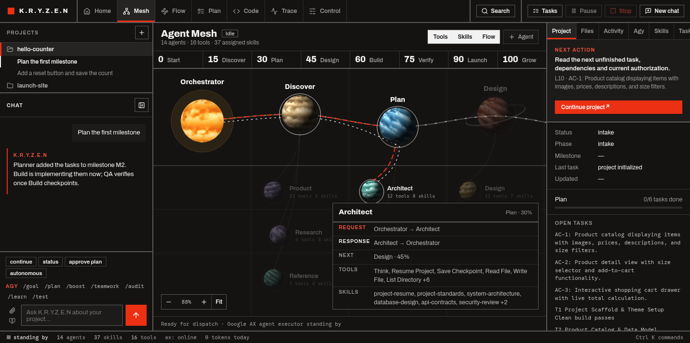

<p></p>

# K.R.Y.Z.E.N: project overview

K.R.Y.Z.E.N is a multi-agent workspace that runs on your own computer. You describe what you want in a chat, an Orchestrator splits the work, and 13 specialist agents research, plan, design, build, test and launch it inside an ordinary project folder.

- **Runs locally:** a Python web app on `127.0.0.1:8770`. It needs no database or pip packages to start, though image features need Pillow.
- **Model:** every agent currently runs on `agy/gemini-3.8-flash` through the Antigravity CLI (`agy`).
- **Resumable:** progress is saved in files, so a run can stop and continue later.
- **Status:** working, but pre-release and single-user. Read [Known issues](#known-issues) before you use it on anything sensitive.

To install it, follow the [setup guide](SETUP.md).

**Contents:** [What it does](#what-it-does) · [The agents](#the-agents) · [Interface](#the-interface) · [Architecture](#architecture) · [Files](#project-files) · [Data](#where-data-lives) · [Settings](#runtime-settings) · [Security](#security-model) · [Testing](#testing) · [Known issues](#known-issues) · [Roadmap](#roadmap)

## What it does

| Capability | What you get |
|---|---|
| **Full product lifecycle** | One request can run from research through planning, building, QA and launch material |
| **Plan approval** | Agents write `docs/plan/PLAN.md`, and you approve it in the Plan view |
| **Parallel work** | Independent tasks run in parallel lanes, with bounded model requests and a saved task graph |
| **Resume** | Say "continue", and agents reload state from `.devpilot/STATE.json`, the plan, the journal and git |
| **Budgets** | Token and time limits per run. It warns at 80%, pauses at 100%, and has a hard cap |
| **Review mode** | Optional: approve every file write as a diff |
| **Project memory** | Agents save decisions and conventions to `.devpilot/memory.md` and reuse them |
| **Full trace** | Every model call and tool call, with a timeline, inspector, replay and JSONL export |
| **Images** | Paste or attach images, share your screen, and capture screenshots of the running app |
| **Editable team** | Change any agent's prompt, model, tools and skills from the app |
| **Skills** | Skill library with usage stats, version history, rollback, imports, and drafts created from past runs |
| **Code workspace** | Editor, terminal, background jobs, search, Git, app preview, tests and project references |

## The agents

The Mesh view lays the team out as a journey from 0 to 100.

| Progress | Stage | Agents | Main output |
|---|---|---|---|
| 0 | **Start** | Orchestrator | Reads the request, resumes state, delegates |
| 15 | **Discover** | Product, Research, Reference | Product requirements, `docs/research/BRIEF.md`, `docs/references/` |
| 30 | **Plan** | Architect, Planner | System design, `docs/plan/PLAN.md` |
| 45 | **Design** | Design | Design system and wireframes |
| 60 | **Build** | Build | Code, commits, checkpoints |
| 75 | **Verify** | QA | Browser tests, `docs/qa/REPORT.md` |
| 90 | **Launch** | DevOps, Production | Deployment, security hardening, release checks |
| 100 | **Grow** | SEO, Marketing, Content | Search audits, launch plan, copy and docs |

| Agent | Role | Max steps | Tools | Skills |
|---|---|---:|---:|---:|
| Orchestrator | Project lead | 80 | 10 + delegation | 9 |
| Product | Product manager | 45 | 11 | 5 |
| Research | Market and tech researcher | 40 | 6 | 3 |
| Reference | Visual reference researcher | 50 | 7 | 4 |
| Architect | System architect | 50 | 12 | 10 |
| Planner | Project planner | 40 | 7 | 11 |
| Design | UI/UX designer | 50 | 11 | 12 |
| Build | Full-stack engineer | 90 | 12 | 12 |
| QA | QA engineer | 70 | 9 | 7 |
| DevOps | DevOps and security | 60 | 9 | 7 |
| Production | Production manager | 50 | 10 | 6 |
| SEO | SEO specialist | 45 | 10 | 6 |
| Marketing | Marketing manager | 45 | 10 | 6 |
| Content | Content specialist | 45 | 9 | 5 |

**The 16 tools agents can use:** Think, Web Search, Fetch Page, Browser, Shell, Antigravity CLI, Read File, Write File, List Directory, Job Status, Create Project, List Projects, Resume Project, Save Checkpoint, List Skills, Read Skill.

**Skills:** this install has 65 skills in the vault, and 49 are assigned to agents.

## The interface

| Area | Purpose |
|---|---|
| **Projects sidebar** | Lists projects and their chats. **+** adds a folder or a new project. Right-click for New chat, Open in Code, Open plan, Rename, Copy path and Remove from list |
| **Chat** | Talk to the Orchestrator, with quick prompts, `/goal` and other slash commands, and image attachments |
| **Home** | Running work, attention list, run queue, spend, health, projects and recent chats. Tabs for screenshots, skills, memory and runtime settings |
| **Mesh** | The 0-to-100 journey. Hover for request and response links; click an agent to edit it |
| **Flow** | Canvases saved as Obsidian files, which can guide how agents hand off work |
| **Plan** | Milestones, Markdown and preview tabs, plus plan approval |
| **Code** | Project editor with terminal, run, Agy logs, search, Git, preview, tests and references |
| **Trace** | Timeline and log of a run, with an inspector and export |
| **Control** | Appearance, agents, prompt blocks, tools, skills, projects, models, services and raw files |
| **Command palette** | <kbd>Ctrl</kbd> + <kbd>K</kbd> reaches any view, action, chat, project or file |

The look follows the Modernist design system: flat, square corners, 2px rules, Archivo type and a single red accent.

## Architecture

<p></p>

1. The **browser** sends your message to `server.py`, then follows the run through a live event stream.
2. The **engine** loads the agents and runs the Orchestrator, which delegates through tool calls. Requests are limited by the bounded queue in `orchestration.py`.
3. Each **model call** goes through the Antigravity CLI.
4. Each **tool call** goes through the bridge, which keeps file access inside the workspace and runs shell commands in a Bubblewrap sandbox.
5. **Results** are written to the project folder, and traces and usage are recorded for the Trace and Home views.

Agents are defined as Markdown notes in the vault. `workflow/build_workflow.py` compiles them into `workflow/ai-dev-agent.json`, which the engine loads. Saving an agent in the app does this automatically.

## Project files

```text
├── README.md                   Short introduction
├── AGENTS.md, GEMINI.md        Instructions for CLI agents working on this repo
├── docs/
│   ├── OVERVIEW.md             This document
│   ├── SETUP.md                Install guide, 0 to 100
│   └── assets/                 Animations and screenshots
└── agent/
    ├── runtime.env.example     Copy to runtime.env
    ├── bridge/pc_bridge.py     Sandboxed shell, files, agy, browser, project actions
    ├── workflow/               Creates agents and templates; compiles agent definitions
    └── jarvis/                 The web app (below)
```

| File in `agent/jarvis/` | Responsibility |
|---|---|
| `server.py` | HTTP API, static files, chat sessions, live events |
| `engine.py` | Runs agents and tools, retries, budgets, pause and stop |
| `orchestration.py` | Request limits and the saved parallel task graph |
| `brain.py` | Project memory, repo map, failure playbooks, verify policy |
| `diet.py` | Keeps prompts small without hiding anything from you |
| `telemetry.py` | Trace spans, stored outputs, usage ledger |
| `media.py` | Image uploads, screenshots, image analysis |
| `mesh.py`, `control.py`, `forms.py` | Editing agents, settings and raw files; services |
| `studio.py` | Flow canvases and plan files |
| `skills2.py`, `skill_pack.py`, `capability_pack.py` | Skill insights and versions; installable agents and skills |
| `codetools.py`, `project_logic.py` | Code workspace helpers, project creation and references |
| `ops.py`, `runtime_settings.py` | Approvals, health checks, project overview; runtime settings |
| `index.html`, `studio.js`, `execution.js`, `panel-resize.js` | Page, main script, Flow and Plan views, task graph, panel resizing |
| `assets/journey.js` | The Mesh view |
| `ui/*.js` | Home, Trace, palette, review, projects, run status, images |
| `ui/base.css`, `ui/modernist.css`, `ui/mesh.css`, `assets/modernist.css`, `assets/icons.css` | Layout, shell theme, mesh, design system, icons |
| `tests/` | Python tests and browser checks |

## Where data lives

| Data | Location | In git |
|---|---|---|
| Projects | `KRYZEN_WORKSPACE`, one folder each | No (not in this repo) |
| Project state | `<project>/.devpilot/` (`STATE.json`, `journal.jsonl`, `memory.md`, `execution.json`) | No |
| Project docs | `<project>/docs/` (research, references, design, plan, QA) | No |
| Added folders and hidden projects | `.linked-projects.json`, `.hidden-projects.json` in the workspace | No |
| Agents, skills, templates, flows | `<vault>/_DevPilot/` | No |
| Chats, traces, usage | `agent/jarvis/sessions/` | No (ignored) |
| Background job logs | `agent/bridge/jobs/` | No (ignored) |
| Machine settings | `agent/runtime.env` | No (ignored) |
| Compiled agents | `agent/workflow/ai-dev-agent.json` | Yes |

## Runtime settings

Change these under **Home > Runtime settings**. They apply to new runs.

| Setting | Default | Meaning |
|---|---:|---|
| Token budget per run | 2,000,000 | Warns at 80%, pauses at 100% |
| Hard cap per run | 10,000,000 | Never auto-resumes past this |
| Time budget per run | 0 | Minutes; 0 means no limit |
| Auto-resume after budget | On, 30 s | Countdown before continuing after a budget pause |
| Auto-continue | On, 3 times | After a step limit or temporary failure |
| Parallel model requests | 4 | Adjusts down on rate limits |
| Parallel task lanes | 4 | For task graphs |
| Tool results kept in full | 2 | Older ones become short stubs |
| Chat messages kept in full | 12 | Older history is summarized |
| Auto-compact | 60,000 tokens | Long runs fold earlier steps into a summary |
| Review mode | Off | Approve every file write as a diff |
| Learn project memory | On | After each run |
| Screenshot on finish | On | Captures the running app |

## Security model

| Protection | How it works |
|---|---|
| **Local only** | The server binds to `127.0.0.1` and checks the `Host` header |
| **Request checks** | POST requests need an `X-Jarvis` header and a same-origin `Origin` |
| **Workspace boundary** | File tools refuse paths outside the workspace and folders you added, including through symlinks |
| **Sandbox** | Agent shell commands run in Bubblewrap, with your home folder hidden |
| **Protected vault** | Inside the sandbox, `_DevPilot` is read-only |

There is no login, because it assumes one person on their own computer. Don't expose it to a network.

## Testing

| Suite | Result |
|---|---|
| Python tests in `agent/jarvis/tests` | 99 tests: 83 pass, 16 fail |
| Browser checks (`browser_*.js`) | Not run recently; `browser_layout.js` still refers to the old mesh |

The same 16 tests failed on the last commit too. Twelve are errors and four are assertion failures:
- Five need Pillow, which isn't installed on this machine.
- Most of the rest target an engine function, `_stream`, that was removed in the move to `agy`, or expect the old project list behaviour.

Run them from `agent/jarvis/tests`:

```bash
python3 -m unittest test_server test_studio test_reliability test_orchestration test_capabilities test_upgrade
```

## Known issues

### Fix first

1. **Sudo password in plain text:** it's hard-coded in `AGENTS.md`, `GEMINI.md`, `index.html`, `engine.py`, `pc_bridge.py`, `setup_product_mesh.py`, `ai-dev-agent.json` and `models_report.md`. Agent prompts include it, so the model provider receives it. Rotate it and remove it from these files.
2. **Secrets in git history:** old commits contain the sudo password, API keys and tokens. Rotate them, and clean the history before adding a remote.
3. **Sudo skips the sandbox:** any agent shell command containing the word `sudo` runs outside Bubblewrap. Together with item 1, an agent or a malicious web page it reads could get root access.
4. **Permissions off by default:** `agy` runs with `--dangerously-skip-permissions` unless a call turns it off.

### Other issues

| Issue | Detail |
|---|---|
| **n8n leftovers** | Agent definitions still use n8n's file format and node names (`ai-dev-agent.json`, `build_workflow.py`). They work, but should move to a clean format |
| **Out-of-date test suite** | See [Testing](#testing) |
| **Out-of-date comments and names** | `engine.py` still says it talks to NVIDIA NIM; the code and the repo folder `Space/n8n` still use old names like Jarvis and DevPilot |
| **Old CSS** | `ui/base.css` is merged from older sheets, and `ui/modernist.css` overrides much of it. It could be simplified |
| **Icon font** | Still the full 220 KB file; it could be reduced to the icons in use |
| **Not tested in a real run** | The mesh's live-run animation has only been simulated |
| **Add Agent** | Uses a browser prompt rather than a proper dialog |

## Roadmap

These 26 ideas would extend K.R.Y.Z.E.N from building products to covering online work in general. The **Today** column shows what already exists. Sizes are rough estimates: **S** is days, **M** is weeks, **L** is a month or more.

### Foundations

Most other ideas depend on these, so build them first.

| # | Idea | What it adds | Today | Size |
|---:|---|---|---|---|
| 24 | **Secrets vault and spending limits** | Per-agent credentials, budgets and an audit log | Budgets per run only; secrets in plain text | M |
| 21 | **Connector marketplace** | One-click, permission-scoped links to Gmail, Drive, GitHub, Stripe and more, using MCP | None | L |
| 22 | **Scheduled and event triggers** | Start work on a timer, or when an email or webhook arrives | None; only auto-continue after a failure | M |
| 23 | **Approval inbox on your phone** | Approve spending, sending or publishing from anywhere | Review mode and attention list, desktop only | M |
| 25 | **Shared memory** | Long-term record of clients, preferences and decisions | Memory per project only | M |
| 26 | **Workflow templates** | Reusable playbooks such as "launch a store" | Project template and Flow canvases | M |

### Getting work and earning

| # | Idea | What it adds | Today | Size |
|---:|---|---|---|---|
| 1 | **Freelance desk** | Finds Upwork and Fiverr jobs, writes proposals, tracks scope and invoices | None | L |
| 2 | **Client portal** | A page per client with progress, approvals and deliverables | None | M |
| 3 | **Payments and invoicing** | Stripe and PayPal billing, reminders, bookkeeping exports | None | M |
| 4 | **Sales agent** | Finds leads, writes personal outreach, manages a CRM pipeline | None | L |
| 5 | **Store operator** | Runs Shopify or WooCommerce listings, stock, orders and refunds | None | L |

### Communication

| # | Idea | What it adds | Today | Size |
|---:|---|---|---|---|
| 6 | **Inbox agent** | Sorts and drafts replies across email, Telegram, WhatsApp and Slack, and sends after approval | None | L |
| 7 | **Customer support** | Answers tickets from a knowledge base and escalates the rest | None | M |
| 8 | **Calendar and meetings** | Scheduling, transcripts, summaries, follow-up tasks | None | M |
| 9 | **Translation** | Localizes sites, documents and support, including Persian | The chat handles Persian text; no dedicated agent | S |

### Marketing and content

| # | Idea | What it adds | Today | Size |
|---:|---|---|---|---|
| 10 | **Social scheduler** | Plans, posts and reports across Instagram, X, LinkedIn and TikTok | Marketing and Content agents write plans and copy, but can't post | M |
| 11 | **Video and image studio** | Ads, shorts, thumbnails, voiceovers | Image input and screenshots only | L |
| 12 | **SEO and ads** | Tracks rankings, publishes content, tunes ad spend within a budget | SEO agent audits and advises; no ad accounts | M |
| 13 | **Newsletter** | Writes, sends and tests campaigns | Content agent can write them; no sending | S |

### Research and operations

| # | Idea | What it adds | Today | Size |
|---:|---|---|---|---|
| 14 | **Web research** | Monitors competitors and prices, sends a sourced weekly brief | Research agent on request; needs triggers to repeat | S |
| 15 | **Browser worker** | Fills forms and portals with no API, and pauses for sign-off | Browser tool exists, built for QA | M |
| 16 | **Data pipeline** | Scrapes, cleans and turns data into live dashboards | Build agent can code one per project | M |
| 17 | **Bookkeeping** | Tracks expenses, reconciles accounts, prepares tax paperwork for an accountant | None | L |
| 18 | **Contracts and documents** | Drafts, compares and flags risky clauses for a person to review | None | M |

### Shipping and running software

| # | Idea | What it adds | Today | Size |
|---:|---|---|---|---|
| 19 | **Deploy agent** | Hosting, domains, SSL and rollbacks from chat | DevOps and Production agents prepare deployments; no hosting connections | M |
| 20 | **Uptime and bug fixing** | Watches errors, opens a fix and asks you to approve it | None; needs triggers | M |

### Suggested order

| Phase | Work | Why |
|---|---|---|
| **0. Make it safe** | The four items under [Fix first](#fix-first), and repair the test suite | Nothing should act online until these are fixed |
| **1. Foundations** | 24, then 21, 22, 23 | Credentials, connections, automatic starts and remote approval |
| **2. Quick wins** | 14, 13, 9, then 25, 26 | They mostly reuse existing agents |
| **3. Daily operations** | 6, 8, 10, 12, 19, 20 | Regular, recurring value |
| **4. Earning** | 3, 2, 1, 4, 5, 7 | They move real money or face customers, so they need phases 0 and 1 |
| **5. Specialist work** | 15, 16, 11, 17, 18 | Higher risk or a bigger build |

### Rules for agents that act online

- **Ask first:** sending, publishing, spending and deleting always need your approval until you choose otherwise for that action.
- **Limit access:** each agent gets only the accounts and permissions its job needs.
- **Record everything:** every outside action goes in an audit log you can review.
- **Respect the platform:** freelance sites, social networks and stores restrict automation in their terms, so check each one and prefer official APIs. Otherwise a browser worker could get your account banned.
- **Keep a person responsible:** bookkeeping, tax and contract output is a draft for a qualified person to check.
