<p></p>

# Setup guide, 0 to 100

This guide takes you from an empty Linux machine to a team of AI agents working on your first project. It takes about 15 minutes.

K.R.Y.Z.E.N is a web app you run on your own computer. You describe what you want in a chat, and an Orchestrator hands the work to 13 specialist agents for research, planning, building, testing and release. Your projects stay in ordinary folders on your disk.

<p>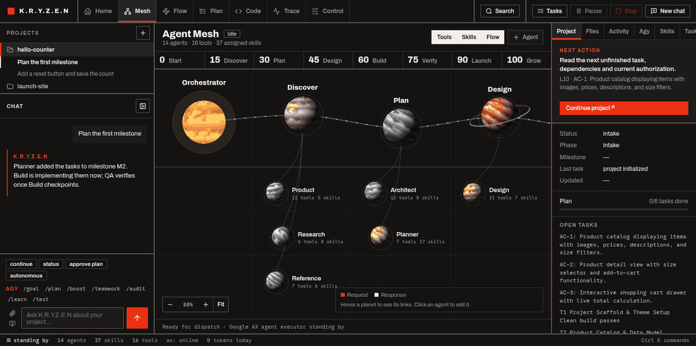</p>

<p></p>

| Progress | Step | Done when |
|---|---|---|
| 0 → 15 | [Install the tools](#1-install-the-tools) | `agy --version` prints a version |
| 15 → 35 | [Get the code](#2-get-the-code-and-set-your-paths) | `agent/runtime.env` has your paths |
| 35 → 55 | [Create the agent team](#3-create-your-agent-team) | 14 notes exist in the vault's `Agents` folder |
| 55 → 70 | [Start the app](#4-start-the-app) | `/health` answers `{"ok": true, ...}` |
| 70 → 90 | [Add a project and chat](#5-add-your-first-project) | The project's chat appears in the sidebar |
| 90 → 100 | [Plan, build, ship](#6-plan-build-and-ship) | The plan is finished and QA has run |

---

## 1. Install the tools

<p>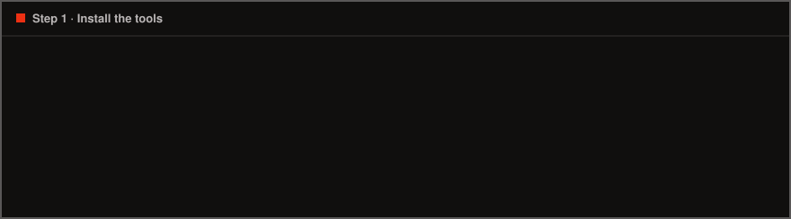</p>

You need these on your machine:

| Tool | Why | Check |
|---|---|---|
| Python 3 | Runs the app | `python3 --version` |
| Pillow | Image uploads and screenshots in chat (optional) | `python3 -c "import PIL"` |
| Git | Project history and checkpoints | `git --version` |
| Antigravity CLI (`agy`) | The model every agent runs on | `agy --version` |
| Bubblewrap (`bwrap`) | Sandboxes agent shell commands | `bwrap --version` |
| Chromium | Browser QA and screenshots (optional) | `chromium --version` |

Arch and Omarchy:

```bash
sudo pacman -S --needed git python python-pillow bubblewrap chromium
```

Debian and Ubuntu:

```bash
sudo apt install git python3 python3-pil bubblewrap chromium
```

Install `agy` and sign in by following Antigravity's own instructions. Agents can't run until this works, so test it now:

```bash
agy -p "Reply with the word ready"
```

## 2. Get the code and set your paths

<p>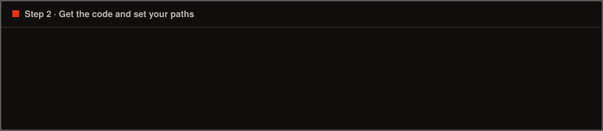</p>

```bash
git clone <your-repo-url> kryzen
```

```bash
cd kryzen/agent
```

```bash
cp runtime.env.example runtime.env
```

```bash
sed -i "s#/home/YOU#$HOME#g" runtime.env
```

```bash
mkdir -p ~/Projects/devpilot
```

`runtime.env` holds these settings:

| Setting | Meaning | Default in the example |
|---|---|---|
| `KRYZEN_WORKSPACE` | The folder that holds your projects | `~/Projects/devpilot` |
| `PC_BRIDGE_WORKSPACE` | The same folder, used by the tool bridge | `~/Projects/devpilot` |
| `KRYZEN_VAULT` | Where agent notes, skills and templates live | `~/Projects/devpilot` |
| `JARVIS_PORT` | The web app's port | `8770` |
| `PC_BRIDGE_DISABLE_SANDBOX` | Set to `1` to run agent commands outside the sandbox | `0` |

> [!CAUTION]
> `runtime.env` is ignored by git, so keep machine-specific settings there. Leave the sandbox on unless you have a specific reason to turn it off.

## 3. Create your agent team

<p>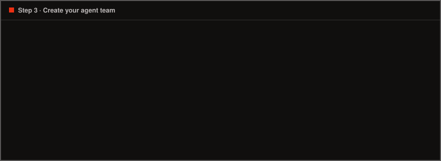</p>

Run these from `kryzen/agent`. Each one writes into your vault, and you can safely re-run the skill installers.

Load your settings:

```bash
set -a; . ./runtime.env; set +a
```

Create the project templates:

```bash
python3 workflow/create_templates.py
```

Create the 14 agents:

```bash
python3 workflow/setup_product_mesh.py
```

Install the skills:

```bash
python3 jarvis/skill_pack.py --install
```

Add the growth specialists and design workflow:

```bash
python3 jarvis/capability_pack.py --install
```

Link skills and templates so the tool bridge can find them:

```bash
ln -sfn "$KRYZEN_VAULT/_DevPilot/Skills" skills
```

```bash
ln -sfn "$KRYZEN_VAULT/_DevPilot/Templates" templates
```

Check the result. This should print `14`:

```bash
ls "$KRYZEN_VAULT/_DevPilot/Agents" | wc -l
```

## 4. Start the app

<p>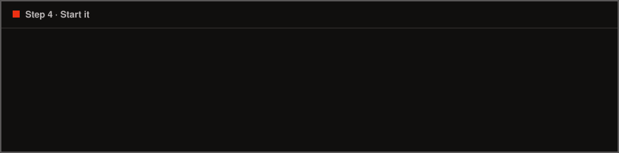</p>

```bash
./jarvis/start.sh
```

Open **http://127.0.0.1:8770**. You should see the agent mesh, your team laid out as a journey from 0 to 100:

<p>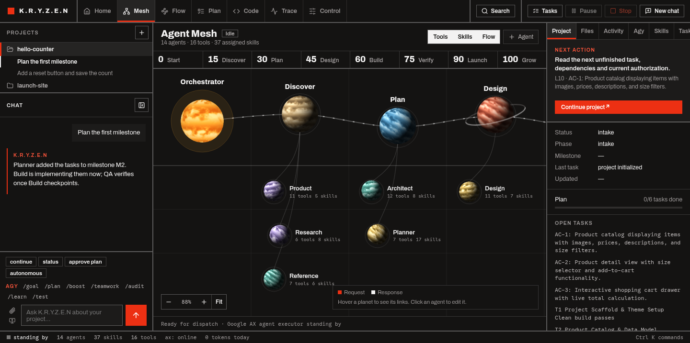</p>

### Keep it running with systemd (optional)

This starts the app when you log in and restarts it if it crashes. Run it from `kryzen/agent`:

```bash
mkdir -p ~/.config/systemd/user
```

```bash
sed "s#/home/kryazzy/Space/n8n/agent#$PWD#g" jarvis/jarvis.service > ~/.config/systemd/user/jarvis.service
```

```bash
systemctl --user daemon-reload
```

```bash
systemctl --user enable --now jarvis
```

Read its logs with:

```bash
journalctl --user -u jarvis -f
```

## 5. Add your first project

The **Projects** list sits above the chat. Every folder in your workspace appears there automatically.

1. Click **+** next to **Projects**.
2. Choose how to start:
   - **Use this folder** adds a folder you already have. Browse to it first.
   - **New project** creates one from the template, with a brief, plan and QA docs ready to fill in.
3. Click a project to select it. Its chats are listed underneath; click a chat to open it.
4. Right-click a project for **New chat**, **Open in Code**, **Open plan**, **Rename**, **Copy path** and **Remove from list**. Removing only takes it off the list: its files and chats stay on your computer, and you can add the folder again with **+**.

<p>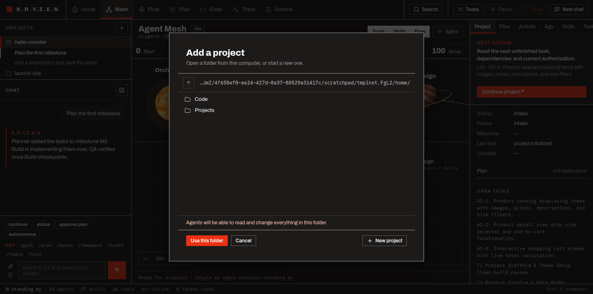</p>

> [!WARNING]
> Agents can read and change everything in a folder you add. Folders outside your workspace also become writable inside the sandbox. You can only add folders inside your home directory, and hidden folders are refused.

Now say what you want in the chat. You don't need special wording:

```text
Build a small counter app with increment, decrement and reset, and keep the count across reloads.
```

<p>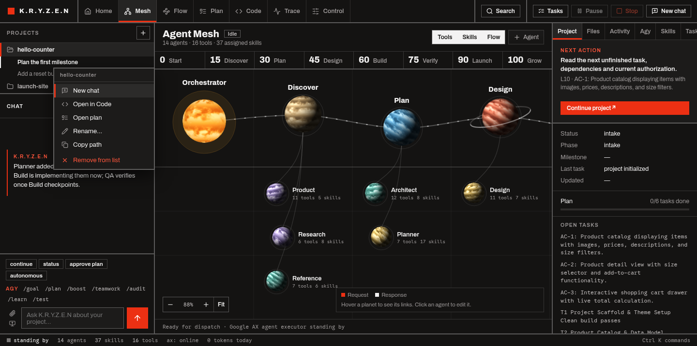</p>

## 6. Plan, build and ship

<p></p>

The work moves through these stages, and every step is saved in the project's `docs/` folder, so you can stop and continue at any time.

| Stage | Who | What you get |
|---|---|---|
| Research | Research, Reference | `docs/research/BRIEF.md`, `docs/references/` |
| Plan | Product, Architect, Planner | `docs/plan/PLAN.md` with milestones |
| **You approve** | You | Click **Approve this plan** in the Plan view |
| Build | Build, Design | Code, commits, checkpoints |
| Verify | QA | `docs/qa/REPORT.md`, browser screenshots |
| Launch | DevOps, Production, SEO, Marketing, Content | Deployment notes and launch material |

<p>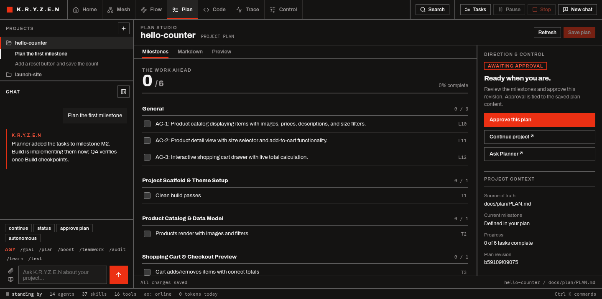</p>

**You've reached 100 when** the plan shows every task done, QA has written its report, and your code is committed in the project folder.

<p>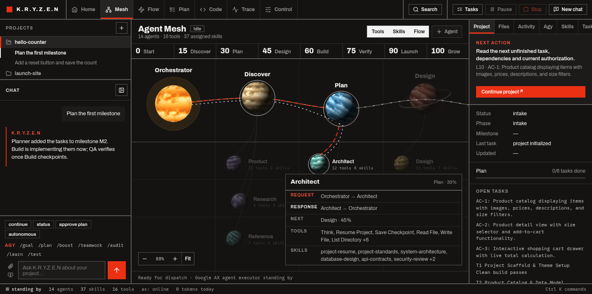</p>

### What each view is for

| View | Use it to |
|---|---|
| **Home** | See running work, what needs you, spend and health |
| **Mesh** | Follow the journey from 0 to 100, hover a planet to see its request and response links, and click an agent to edit it |
| **Flow** | Draw how agents should hand off work |
| **Plan** | Review, edit and approve the plan |
| **Code** | Edit files and use the terminal, Git, search and preview |
| **Trace** | Inspect every model call and tool call in a run |
| **Control** | Change agents, skills, tools, models and appearance |

Press <kbd>Ctrl</kbd> + <kbd>K</kbd> anywhere to search for any view, action, chat or project.

<p>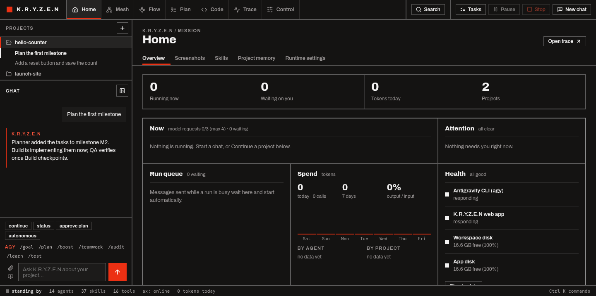</p>

## Troubleshooting

<details>
<summary><b>Agents fail immediately, or chat replies with an error</b></summary>

`agy` isn't working from the app's environment. Run `agy -p "Reply with the word ready"` in the same terminal. Under systemd, also make sure `agy` is on the service's `PATH`.
</details>

<details>
<summary><b>Creating a project says "project template is unavailable"</b></summary>

The `agent/templates` link is missing. Repeat the two `ln -sfn` commands in [step 3](#3-create-your-agent-team).
</details>

<details>
<summary><b>The mesh is empty</b></summary>

`KRYZEN_VAULT` when you ran the setup scripts must match the value the app uses. Check `runtime.env`, then re-run `workflow/setup_product_mesh.py`.
</details>

<details>
<summary><b>Agent shell commands fail with a bwrap error</b></summary>

Check that `bwrap --version` works and that your system allows unprivileged user namespaces. Fix that rather than turning the sandbox off.
</details>

<details>
<summary><b>The port is already in use</b></summary>

Set a different `JARVIS_PORT` in `runtime.env` and start the app again.
</details>

## Updating

Stop the app, pull, then re-run the installers in [step 3](#3-create-your-agent-team). They don't overwrite skills you already have.

```bash
git pull
```

## Project layout

```text
├── README.md              Start here
├── docs/
│   ├── SETUP.md           This guide
│   └── assets/            Images and animations for the docs
└── agent/
    ├── runtime.env.example  Copy to runtime.env
    ├── bridge/            Sandboxed file, shell and agy tools
    ├── workflow/          Creates agents and templates in the vault
    └── jarvis/            The web app
        ├── server.py      HTTP API and static files
        ├── engine.py      Runs agents
        ├── index.html     Page and main script
        ├── studio.js      Flow and Plan views
        ├── ui/            Home, Trace, palette, projects and all CSS
        ├── assets/        Design system, icons, 3D mesh
        ├── tests/         Automated tests
        └── docs/          Design and QA history
```
